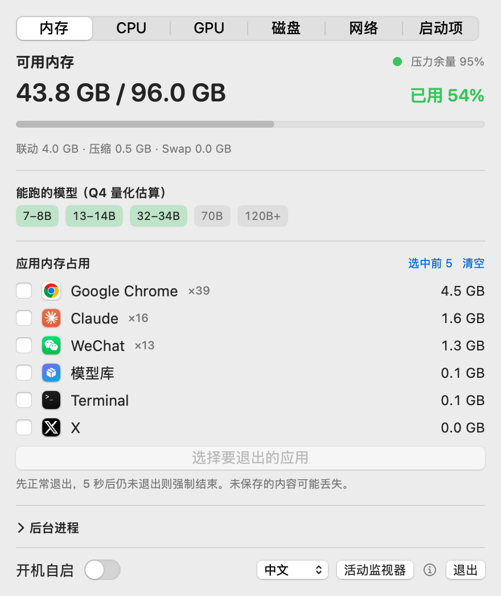
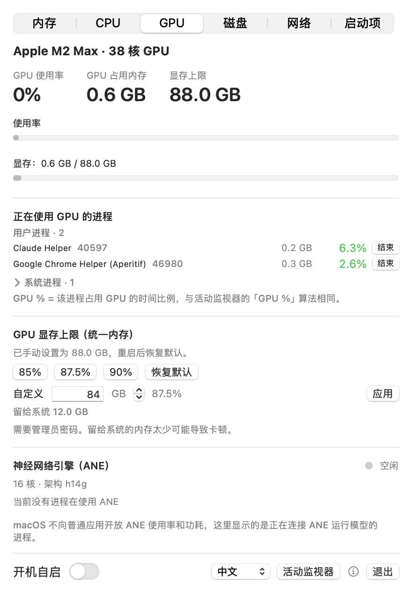
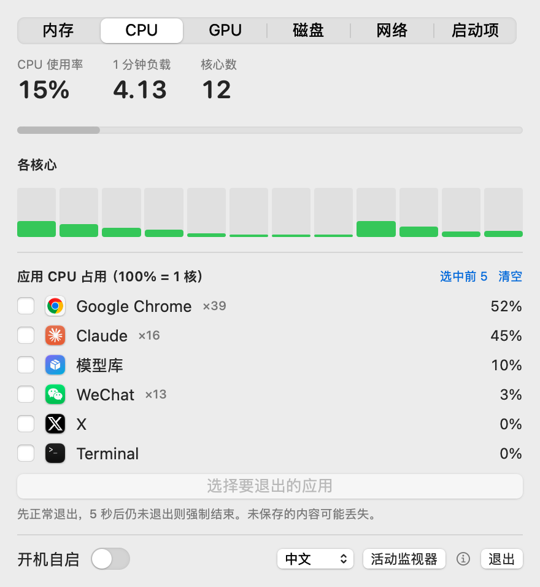
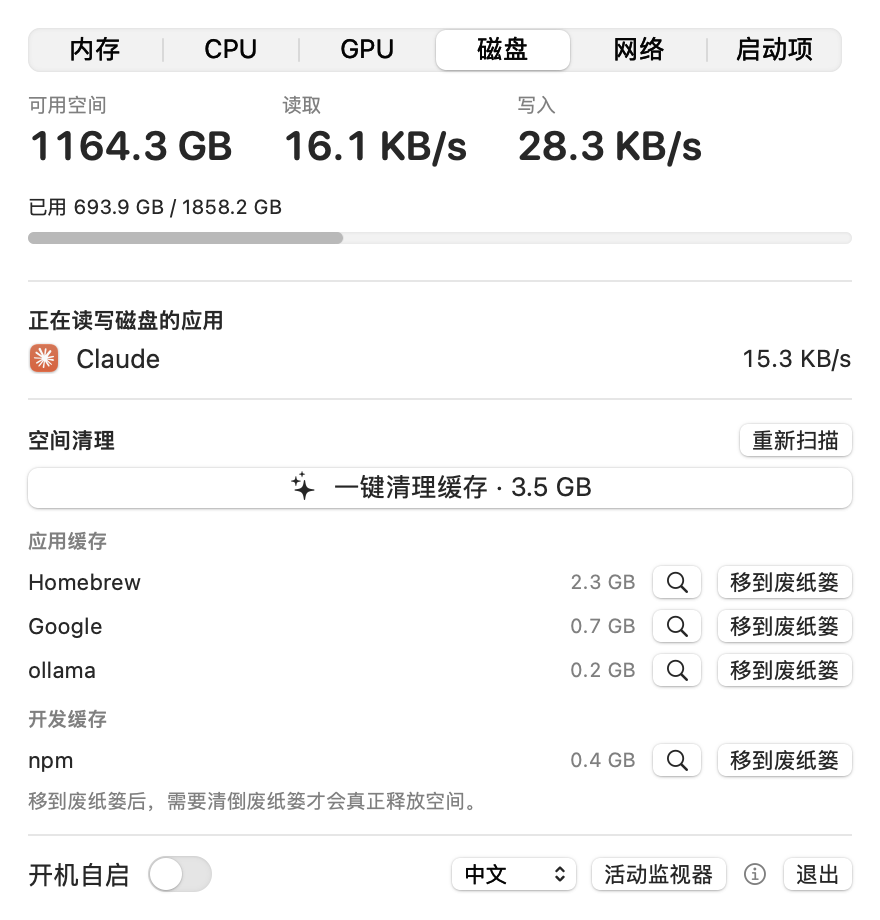
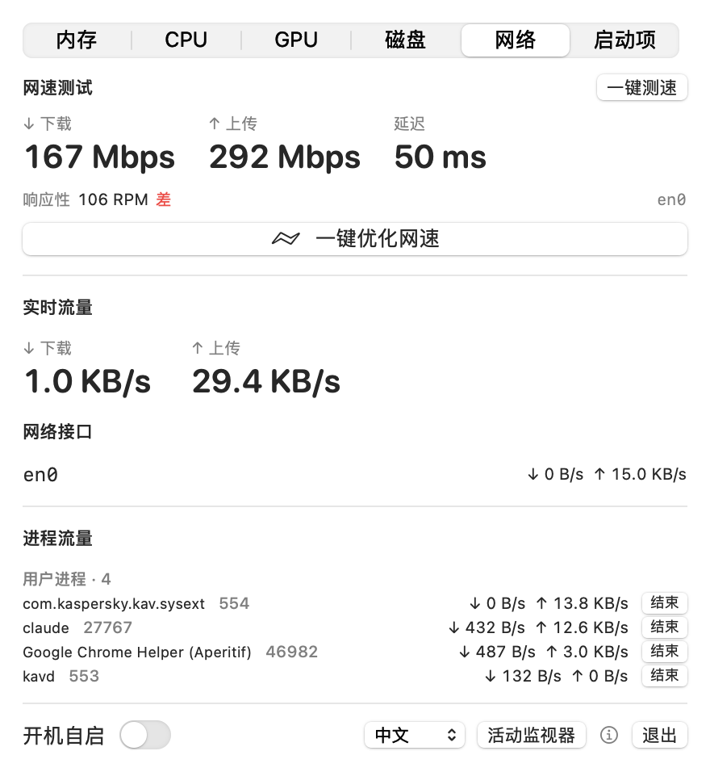
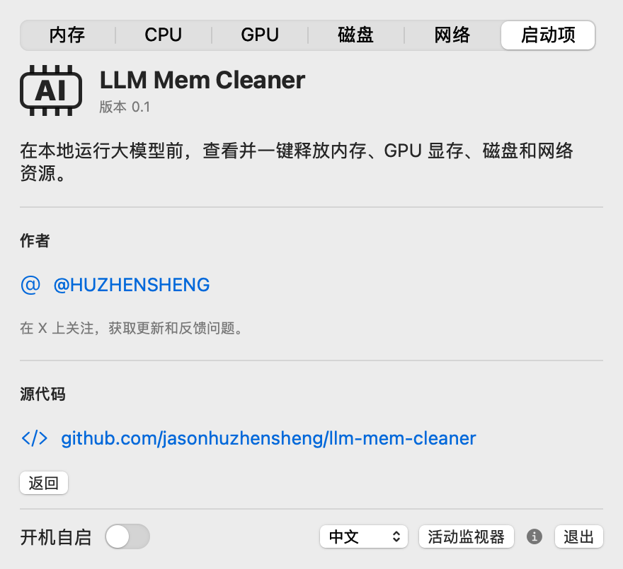

# LLM Mem Cleaner

A macOS menu bar app for freeing up memory, GPU memory, disk and network before running local LLMs (Ollama, MLX, LM Studio).

macOS 菜单栏工具：在本地运行大模型前，查看并一键释放内存、GPU 显存、磁盘和网络资源。

The menu bar shows a memory-chip icon with available GB; the number turns red above 95% usage.

## Screenshots / 截图

<table>
  <tr>
    <th>Memory 内存</th>
    <th>GPU · Neural Engine</th>
  </tr>
  <tr>
    <td></td>
    <td></td>
  </tr>
  <tr>
    <th>CPU</th>
    <th>Disk 磁盘</th>
  </tr>
  <tr>
    <td></td>
    <td></td>
  </tr>
  <tr>
    <th>Network 网络</th>
    <th>About 关于</th>
  </tr>
  <tr>
    <td></td>
    <td></td>
  </tr>
</table>

Regenerate with `build/LLMMemCleaner.app/Contents/MacOS/LLMMemCleaner --screenshots <dir> [light|dark] [zh|en]`.

## Features / 功能

| Tab | What it does |
|---|---|
| **Memory 内存** | Available memory, pressure, swap; which model sizes fit (Q4 estimate, GPU limit aware); per-app memory (helpers grouped) with one-click quit; unload Ollama models |
| **Models 模型** | LLMs currently loaded by Ollama, LM Studio, MLX-Serve, llama.cpp or mlx-lm with memory, file size and context length; warns when the same model is loaded twice or the context is huge; one-click unload (or unload all) |
| **CPU** | Total and per-core usage, load average; per-app CPU with one-click quit |
| **GPU** | Utilization, GPU memory in use, unified-memory wired limit with 85% / 87.5% / 90% / custom presets (`iogpu.wired_limit_mb`, admin, resets on reboot) |
| **Disk 磁盘** | Free space, read/write throughput, per-app disk I/O; scan Ollama / Hugging Face / LM Studio models and caches; one-click cache cleaning |
| **Network 网络** | Speed test (`networkQuality`), Wi-Fi signal, DNS flush + DHCP renew with before/after test, per-process traffic with stop button |
| **Startup 启动项** | Login items, LaunchAgents, LaunchDaemons and Homebrew services with on/off toggles; launch-at-login for this app |

UI in Chinese and English (picker at the bottom of the panel).

## Build / 构建

Requires macOS 14+ and Xcode command line tools.

```bash
./build-app.sh            # builds build/LLMMemCleaner.app
./build-app.sh --install  # also installs to ~/Applications and launches it
```

## Author / 作者

X: [@HUZHENSHENG](https://x.com/HUZHENSHENG) — follow for updates and feedback. / 关注获取更新、反馈问题。

## Notes / 说明

- Quitting apps tries a normal quit first and force-quits after 5 seconds; unsaved work may be lost.
- One-click cache cleaning permanently deletes the contents of `~/Library/Caches/*` (except `com.apple.*`) plus Xcode DerivedData, npm, pip, uv and Gradle caches. Models are never touched by it.
- Changing system daemons, the GPU limit or network settings prompts for an administrator password.
